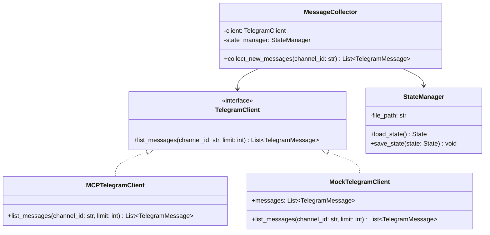

# 📐 Phase 1 설계서: 텔레그램 수집 및 중복 검사

본 설계서는 Phase 1의 요구사항에 근거하여 작성되었으며, `libs/telegram-client` 라이브러리와 `services/collector` 서비스의 상세 소프트웨어 설계를 정의합니다.

---

## 1. 시스템 아키텍처 및 의존성 관계

모듈 간 결합도를 줄이고 유닛 테스트를 원활하게 진행하기 위해 **DIP(의존관계 역전 원칙)**를 적용합니다. `services/collector`는 구체 클래스가 아닌 `TelegramClient` 인터페이스에 의존합니다.



---

## 2. 데이터 모델 설계 (Pydantic)

데이터 유효성 검증과 정적 타입 분석을 위해 `pydantic` 모델을 정의합니다.

### 2.1 `TelegramMessage` 모델
```python
from pydantic import BaseModel
from datetime import datetime
from typing import Optional

class TelegramMessage(BaseModel):
    id: int
    channel_id: str
    text: str
    date: datetime
    sender_id: Optional[str] = None
```

### 2.2 `State` 모델 (상태 관리)
```python
from pydantic import BaseModel, Field
from datetime import datetime
from typing import Dict

class ChannelState(BaseModel):
    last_message_id: int
    last_run: datetime

class State(BaseModel):
    last_message_id: int
    last_run: datetime
    channels: Dict[str, ChannelState] = Field(default_factory=dict)
```

---

## 3. 핵심 인터페이스 및 클래스 설계

### 3.1 `TelegramClient` (추상 인터페이스)
*   **패키지 위치:** `libs/telegram-client/src/telegram_client/interface.py`
*   **메서드:**
    ```python
    from abc import ABC, abstractmethod
    from typing import List
    
    class TelegramClient(ABC):
        @abstractmethod
        def list_messages(self, channel_id: str, limit: int = 100) -> List[TelegramMessage]:
            """특정 채널의 메시지 리스트를 역순(최신순)으로 수집한다."""
            pass
```

### 3.2 `MCPTelegramClient` (구체 구현체)
*   **패키지 위치:** `libs/telegram-client/src/telegram_client/mcp_client.py`
*   **설명:** 텔레그램 MCP 서버의 `list_messages` 도구를 API를 통해 호출하고 결과를 `TelegramMessage` 리스트로 형변환합니다.

### 3.3 `StateManager` (상태 관리자)
*   **패키지 위치:** `libs/state-manager/src/state_manager/manager.py`
*   **기능:** `state.json` 파일의 안전한 입출력을 처리하며, 파일이 없을 경우 최근 24시간을 기준으로 한 초기 `State` 객체를 동적으로 빌드합니다.

### 3.4 `MessageCollector` (수집 오케스트레이션 서비스)
*   **패키지 위치:** `services/collector/src/collector/service.py`
*   **의사코드 (Pseudocode):**
    ```python
    class MessageCollector:
        def __init__(self, client: TelegramClient, state_manager: StateManager):
            self.client = client
            self.state_manager = state_manager
            
        def collect_new_messages(self, channel_id: str) -> List[TelegramMessage]:
            state = self.state_manager.load_state()
            target_last_id = state.channels.get(channel_id, {}).last_message_id or state.last_message_id
            
            # 1. 메시지 가져오기
            raw_messages = self.client.list_messages(channel_id, limit=200)
            
            # 2. 미수집 신규 메시지 수집 (필터링 없이 100% 수집)
            new_messages = [msg for msg in raw_messages if msg.id > target_last_id]
                    
            # 3. 날짜순(과거 -> 최신) 정렬
            new_messages.sort(key=lambda x: x.id)
            
            print(f"Collected {len(new_messages)} new messages for raw storage.")
            return new_messages
            
        def is_research(self, msg: TelegramMessage) -> bool:
            """이 글이 분석 및 테마/종목 기록 대상(리서치 글)인지 판별한다."""
            # URL 링크를 제외한 실제 코멘트 텍스트 추출
            import re
            text_without_urls = re.sub(r"https?://[^\s]+", "", msg.text)
            lines = [l.strip() for l in text_without_urls.split("\n") if l.strip()]
            
            # 실제 코멘트가 3줄 이하면 제외 (단순 링크글 및 짧은 글)
            if len(lines) <= 3:
                return False
            # 광고, 공지사항, 투표 키워드 필터링
            filter_keywords = [
                "광고", "제휴", "공구", "쿠팡 파트너스",
                "공지사항", "[공지]", "★공지", "투표", "설문조사"
            ]
            if any(keyword in msg.text for keyword in filter_keywords):
                return False
            return True
```

---

## 4. 예외 처리 설계
*   **JSON 데시벨 에러:** `state.json`이 깨져서 파싱되지 않는 경우, 파일명을 `state.json.bak`으로 이름을 바꾸고 기본값을 로드하여 배치가 강제 비정상 종료되는 것을 보호합니다.
*   **MCP 커넥션 에러:** MCP 호출 실패 시 1초 대기 후 총 3회 재시도를 진행하며, 최종 실패 시 커스텀 예외 `TelegramCollectionError`를 발생시켜 배치의 흐름을 명확하게 차단합니다.
