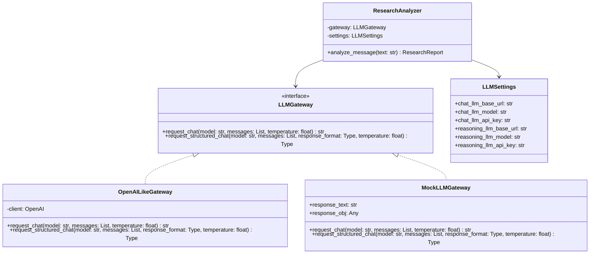

# 📐 Phase 2 설계서: LLM 분석 Gateway 개발

본 설계서는 Phase 2의 요구사항에 근거하여 작성되었으며, `libs/llm-gateway` 라이브러리와 `services/analyzer` 서비스의 상세 소프트웨어 설계를 정의합니다.

---

## 1. 시스템 아키텍처 및 의존성 관계

운영 환경(자체 호스팅 vLLM)과 테스트 환경(OpenAI)이 모두 표준 **OpenAI Chat Completions API 규격**(`/v1/chat/completions`)을 따릅니다. 따라서 `OpenAI` 공식 SDK를 추상화 래퍼로 래핑하고, 환경변수로 `api_key`와 `base_url`을 제어하도록 설계하여 결합도를 최소화합니다.



---

## 2. 데이터 모델 설계 (Pydantic)

추출하려는 지식 구조를 안전하게 역직렬화(Deserialization)하기 위해 Pydantic V2 데이터 모델을 설계합니다.

### 2.1 `ResearchReport` 모델 (정제 결과)
```python
from pydantic import BaseModel, Field
from typing import List

class ResearchReport(BaseModel):
    main_claim: str = Field(
        ..., 
        description="저자가 이 글을 통해 최종적으로 전달하려는 결론 한 줄 요약"
    )
    evidence: List[str] = Field(
        ..., 
        description="주장을 뒷받침하기 위해 본문에서 제시된 구체적인 수치, 관찰 데이터, 팩트 목록"
    )
    logic: str = Field(
        ..., 
        description="저자가 어떤 가정을 토대로 왜 그러한 해석과 결과를 도출했는지 추론 경로 분석"
    )
    risks: List[str] = Field(
        ..., 
        description="원문에서 제기된 리스크 및 사용자가 독립적으로 생각해볼 만한 잠재적 반대 시나리오"
    )
    critical_question: str = Field(
        ..., 
        description="본문 가설의 신뢰성을 검증하기 위해 사용자가 추가 리서치해보아야 할 핵심 질문 1개"
    )
```

---

## 3. 핵심 인터페이스 및 클래스 설계

### 3.1 `LLMGateway` (추상 인터페이스)
*   **패키지 위치:** `libs/llm-gateway/src/llm_gateway/interface.py`
*   **메서드:**
    ```python
    from abc import ABC, abstractmethod
    from typing import Type, TypeVar, Any
    
    T = TypeVar('T')
    
    class LLMGateway(ABC):
        @abstractmethod
        def request_chat(self, base_url: str, api_key: str, model: str, messages: list, temperature: float = 0.2) -> str:
            """일반 텍스트 기반 completions API를 요청한다."""
            pass

        @abstractmethod
        def request_structured_chat(self, base_url: str, api_key: str, model: str, messages: list, response_format: Type[T], temperature: float = 0.2) -> T:
            """Structured Output 규격을 준수하여 Pydantic 모델 형태의 데이터를 받아온다."""
            pass
```

### 3.2 `OpenAILikeGateway` (구체 구현체)
*   **패키지 위치:** `libs/llm-gateway/src/llm_gateway/openai_gateway.py`
*   **설명:** `openai` 파이썬 패키지를 활용하며, 생성자로 고정되는 클라이언트가 아닌 호출 시점에 `base_url`과 `api_key`를 전달받아 동적으로 스위칭 구동되는 구조를 사용합니다.

### 3.3 `LLMSettings` (환경변수 관리)
*   **패키지 위치:** `services/analyzer/src/analyzer/config.py`
*   **설명:** `pydantic-settings` 라이브러리를 사용하여 `.env`에 정의된 Generic 환경변수를 검증하고 로드합니다.

### 3.4 `ResearchAnalyzer` (분석 서비스)
*   **패키지 위치:** `services/analyzer/src/analyzer/service.py`
*   **프롬프트 설계 (Prompt Design):**
    *   **System Prompt:** 
        > "너는 투자 리서치 분석가다. 입력된 주식 리서치 코멘트를 파싱하여, 핵심 주장, 근거 데이터, 판단의 논리, 리스크, 그리고 critical한 질문을 균형있게 추출해라. 원문에 없는 전망을 확정적 사실처럼 쓰지 말고, 추론은 명확히 논리 항목으로 분류해라."
    *   **User Prompt:**
        > "아래 리서치 원문을 정밀하게 분석해라.\n\n[원문]\n{text}"

---

## 4. 예외 및 복구 설계 (Retry mechanism)
*   **Structured Parsing 실패 대응:** 
    *   LLM 응답이 온전한 JSON 규격이 아니거나, 필드 누락이 발생하는 경우 `pydantic.ValidationError`가 감지됩니다.
    *   이 경우 `ResearchAnalyzer`는 즉각 에러 로그를 남기고, 최대 2회까지 동일 Gateway 요청을 재시도합니다. (Retry 시점에는 온전한 JSON을 반환하라는 교정 프롬프트를 덧붙여 전송합니다.)
    *   최종 실패 시, 후속 배치 작업을 망가뜨리지 않도록 커스텀 예외 `LLMAnalysisError`를 명확하게 발생시켜 상위 프로세스로 전파합니다.
