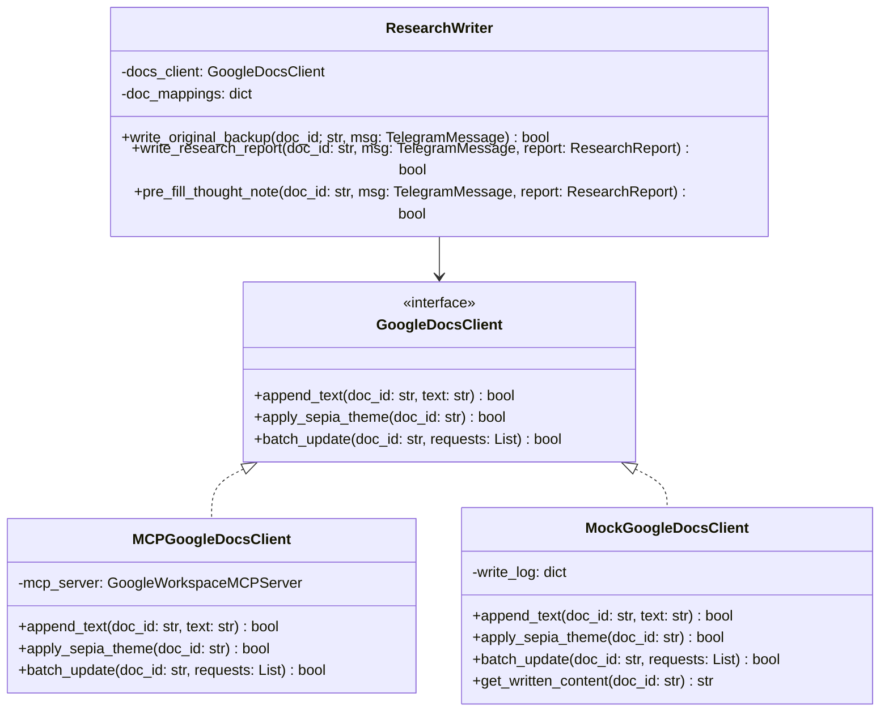

# 📐 Phase 3 설계서: 구글 Docs 기록 및 생각노트 Pre-fill 개발

본 설계서는 Phase 3의 요구사항에 근거하여 작성되었으며, `libs/google-docs-client` 라이브러리와 `services/writer` 서비스의 구체적인 소프트웨어 설계를 정의합니다.

---

## 1. 아키텍처 및 의존성 관계

Google Docs API의 쓰기 및 서식 적용 작업은 batchUpdate 요청(JSON payload) 구조로 통합됩니다. 비즈니스 로직과의 강결합을 방지하기 위해 `GoogleDocsClient` 추상 계층을 설계하고, 이를 통해 호출을 캡슐화합니다.



---

## 2. 인터페이스 및 서비스 상세 설계

### 2.1 `GoogleDocsClient` 추상 인터페이스
*   **패키지 위치:** `libs/google-docs-client/src/google_docs_client/interface.py`
*   **메서드:**
    ```python
    from abc import ABC, abstractmethod
    
    class GoogleDocsClient(ABC):
        @abstractmethod
        def append_text(self, doc_id: str, text: str) -> bool:
            """문서의 맨 끝에 지정된 텍스트를 추가한다."""
            pass

        @abstractmethod
        def apply_sepia_theme(self, doc_id: str) -> bool:
            """문서의 배경색을 세피아 크림색(#FDF6E3)으로 변경한다."""
            pass

        @abstractmethod
        def batch_update(self, doc_id: str, requests: list) -> bool:
            """커스텀 batchUpdate API 요청 리스트를 전송하여 실행한다."""
            pass
```

### 2.2 `ResearchWriter` 서비스
*   **패키지 위치:** `services/writer/src/writer/service.py`
*   **기능 구성:**
    1.  `write_original_backup(doc_id, msg)`: 원문 보관 포맷에 맞춰 지정된 백업 Docs 맨 밑에 추가.
    2.  `write_research_report(doc_id, msg, report)`: 핵심 주장, 근거 데이터, 판단 논리, 리스크, 내 생각(미기록), 생각해볼 질문 구조로 테마/종목 Docs 맨 밑에 추가.
    3.  `pre_fill_thought_note(doc_id, msg, report)`: `99_생각노트` Docs 맨 밑에 당일 수집된 식별자와 내 생각 입력란 템플릿(Pre-fill)을 작성.

---

## 3. 포맷팅 템플릿 상세 설계

### 3.1 원문 보관 포맷
```text
━━━━━━━━━━━━━━━━━━
■ {date_str} | {title}
▶ 식별자: [r{message_id}]
▶ 출처: {source}
{raw_text}
```

### 3.2 리서치 보고서 포맷 (테마/종목)
```text
━━━━━━━━━━━━━━━━━━
■ {date_str} | {title}
▶ 식별자: [{prefix}{message_id}]
▶ 출처: {source}
▶ 핵심 주장: {main_claim}
▶ 근거·데이터: 
  - {evidence_1}
  - {evidence_2}
▶ 판단 논리: {logic}
▶ 리스크·반대 시나리오: 
  - {risk_1}
  - {risk_2}
▶ 💭 내 생각: 미기록
▶ ❓ 생각해볼 질문: {critical_question}
```

### 3.3 생각노트 Pre-fill 템플릿
```text
━━━━━━━━━━━━━━━━━━
■ {date_str} 리서치 생각노트 작성 창구
- [{prefix}{message_id}] {title}
  ▶ 💭 내 생각: 
```

---

## 4. 예외 처리 및 안정성 확보
*   **구글 API 속도 제한(Quota Limit) 대응:** 
    *   배치 작업 진행 중 1초당 호출 가능 횟수를 넘지 않도록 `batch_update`를 적극적으로 활용하여 한 문서당 단 1회의 쓰기 트랜잭션으로 요청을 묶어서 처리합니다.
    *   요청이 실패할 경우, 지수 백오프(Exponential Backoff) 규칙을 적용하여 최대 3회 재시도합니다.
