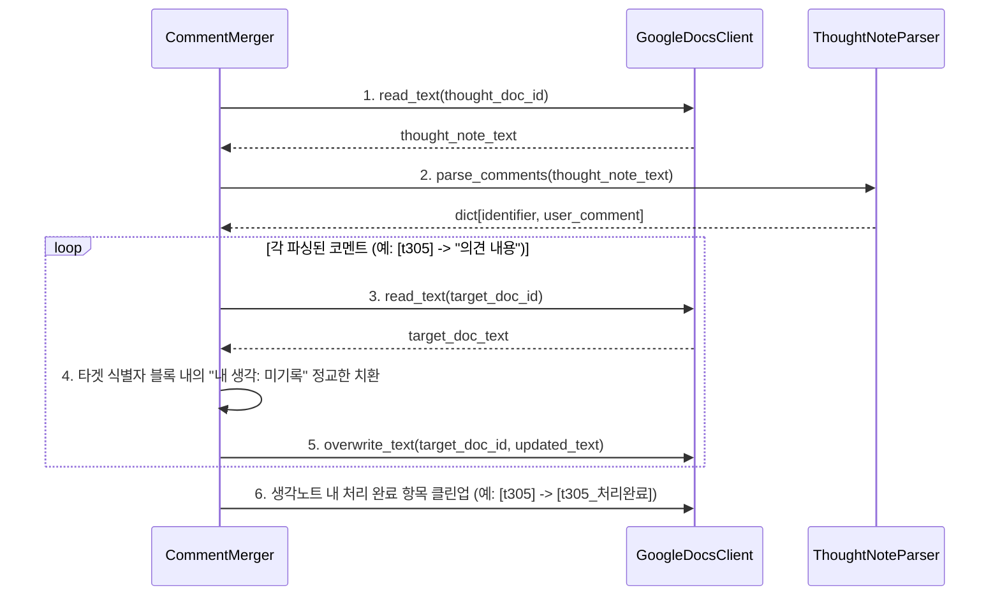

# 📐 Phase 4 설계서: 생각노트 자동 병합(Merge) 개발

본 설계서는 Phase 4의 요구사항에 근거하여 작성되었으며, `services/merger` 서비스의 상세 소프트웨어 설계를 정의합니다.

---

## 1. 시스템 아키텍처 및 텍스트 치환 방식 설계

구글 Docs API의 전체 문서 단순 치환(`replaceAllText`)은 여러 개의 `▶ 💭 내 생각: 미기록` 문구가 존재할 때 특정 식별자 블록을 구분하여 정밀하게 치환하기에 한계가 있습니다. 
따라서 본 시스템은 **"Read-Modify-Write (메모리 편집 후 오버라이트)"** 아키텍처를 채택하여 정밀성을 100% 보장합니다.



---

## 2. 인터페이스 변경 및 확장 설계

### 2.1 `GoogleDocsClient` 추상 인터페이스 확장
*   **추가 메서드:**
    *   `read_text(self, doc_id: str) -> str`: 구글 Docs의 전체 텍스트 내용을 읽어온다.
    *   `overwrite_text(self, doc_id: str, text: str) -> bool`: 구글 Docs의 전체 내용을 지정된 텍스트로 덮어쓴다.

---

## 3. 정밀 텍스트 파싱 및 치환 알고리즘 설계

### 3.1 생각노트 파싱 알고리즘 (`ThoughtNoteParser`)
*   **정규식 패턴:**
    ```python
    import re
    # [t305] 아래 줄의 "▶ 💭 내 생각: 내용"을 매칭 (대소문자 무시)
    pattern = re.compile(
        r"\[([tsfr]\d+)\][^\n]*\n\s*▶\s*💭\s*내\s*생각:\s*([^\n]+)",
        re.IGNORECASE
    )
    ```
*   사용자가 적은 생각이 `미기록`이거나 공백인 경우 딕셔너리 수집에서 배제합니다.

### 3.2 본문 정밀 치환 알고리즘 (`CommentMerger`)
*   본문 전체 텍스트를 줄(Line) 단위 또는 블록 단위로 스캔합니다.
*   **스캔 및 치환 룰:**
    1.  타겟 식별자(예: `[t305]`)가 포함된 줄을 찾습니다.
    2.  해당 줄 아래로 다음 레코드 구분선(`━━━━━━━━━━━━━━━━━━`)이 나타나기 전까지의 줄 중에서 `▶ 💭 내 생각:` 으로 시작하는 줄을 검색합니다.
    3.  해당 줄을 `▶ 💭 내 생각: {사용자 코멘트}`로 교체합니다.
    4.  줄들을 다시 합친 전체 텍스트를 문서에 덮어씁니다.
*   이 방식은 타깃 블록의 바운더리 내에서만 작동하므로, 다른 블록의 `▶ 💭 내 생각: 미기록` 줄을 침범하지 않고 안전하게 정밀 치환합니다.
