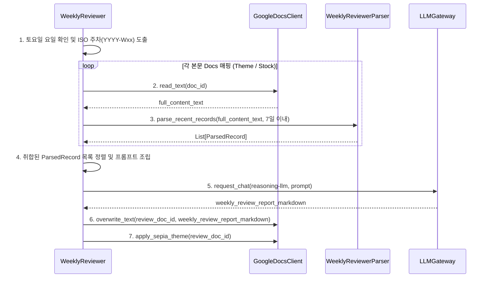

# 📐 Phase 5 설계서: 주간리뷰(Weekly Review) 생성 엔진 개발

본 설계서는 Phase 5의 요구사항에 근거하여 작성되었으며, `services/reviewer` 서비스의 상세 소프트웨어 설계를 정의합니다.

---

## 1. 시스템 아키텍처 및 데이터 흐름 설계

주간 리뷰 프로세스는 지정된 일주일(7일) 동안 축적된 리서치 Docs 본문을 읽어와 메모리 상에서 블록 단위로 파싱한 후, 취합된 데이터를 추론 AI 모델(`reasoning-llm`)에 전달하여 종합 요약 보고서를 작성합니다.



---

## 2. 데이터 구조 및 파싱 설계

### 2.1 `ParsedRecord` 모델
```python
from pydantic import BaseModel
from typing import List, Optional

class ParsedRecord(BaseModel):
    date_str: str          # YYYY-MM-DD
    title: str             # 리서치 글 한 줄 제목
    identifier: str        # [t305] 등
    main_claim: str
    evidence: List[str]
    logic: str
    risks: List[str]
    my_thought: str        # 사용자가 기록한 생각 ("미기록" 등 포함)
    critical_question: str
```

### 2.2 `WeeklyReviewParser` (본문 파서)
*   본문 구글 Docs에서 구분선(`━━━━━━━━━━━━━━━━━━`)으로 나뉘는 개별 분석 블록들을 스캔합니다.
*   **스캔 정규식 패턴:**
    *   개별 레코드는 `■ (YYYY-MM-DD) | (제목)` 형태로 시작합니다.
    *   그 아래 필드들을 줄 단위 또는 패턴 매칭으로 분석하여 `ParsedRecord` 객체 리스트를 추출합니다.
*   **날짜 필터링:** 
    *   `date_str`을 파싱하여, 기준 일자(배치 실행 토요일)로부터 최근 7일(배치 실행일 포함 이전 6일, 총 7일) 범위 내에 존재하는 블록만 리스트에 담습니다.

---

## 3. 프롬프트 템플릿 설계

추론 LLM(`reasoning-llm`)에 종합 지식을 전달할 때 사용하는 프롬프트 구조입니다.

### 3.1 System Prompt
> "너는 전문적인 글로벌 매크로 및 주식 리서치 수석 애널리스트다. 
> 지난 1주일 동안 축적된 리서치 지식 카드와 사용자의 개인 의견(내 생각) 목록이 제공된다. 
> 분석 규칙을 철저히 엄수하여 주간 리서치 종합 성찰 보고서(Weekly Review)를 작성하라.
> 모든 핵심 논리 뒤에는 반드시 근거가 된 원문 날짜를 대괄호로 명시해야 한다(예: [07-12]).
> 전망을 확정적 사실처럼 쓰지 말고, 금융 상품 매수/매도 제안은 절대 포함하지 마라."

### 3.2 User Prompt
```text
아래 취합된 최근 1주일간의 리서치 지식 카드를 바탕으로 주간 리뷰 보고서를 작성해라.

[1주일간 축적된 지식 카드 목록]
{knowledge_cards_text}

[보고서 작성 필수 항목 및 서식]
1. 이번 주 핵심 논리 3가지:
   (저자는 [근거]를 보고 [논리]로 [판단]했다 한 문장 요약 + 상세 부연)
2. 과거 기록 대비 저자의 관점 변화:
   ([이전 관점] ➔ [현재 관점] 형식, 변화 없으면 '변화 없음' 명시)
3. 사용자 생각(💭) 점검 및 대조:
   (사용자가 적은 💭 의견을 분석하여 일치/불일치/의문 대조 성찰. 💭가 비어있다면 기록 권장)
4. 다음 주 관찰 포인트 3가지:
   (검증해야 할 지표나 핵심 이벤트 3가지 도출)
```

---

## 4. 예외 및 한계 설계
*   **데이터 누락 대응:** 7일 이내 추가된 `ParsedRecord`가 0개인 경우, LLM 호출을 건너뛰고 "이번 주 수집된 신규 리서치가 없어 주간리뷰를 생성하지 않습니다." 문구로 채워진 리뷰 문서를 작성하여 런타임 결함을 방지합니다.
