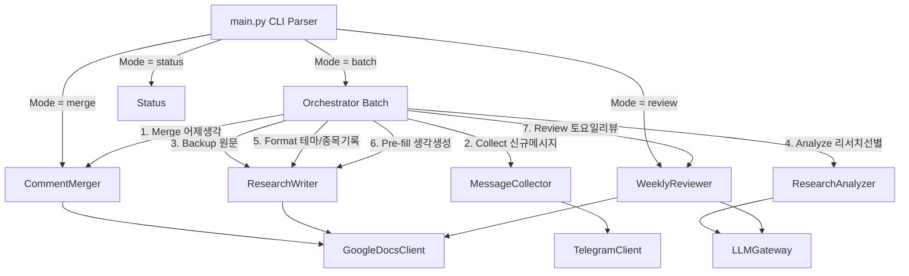

# 📐 Phase 6 설계서: 하이브리드 오케스트레이터 배치(Daily CLI) 통합

본 설계서는 Phase 6의 요구사항에 근거하여 작성되었으며, 배치 진입점 `program/src/main.py`와 전체 오케스트레이션 파이프라인의 아키텍처 상세 설계를 정의합니다.

---

## 1. 아키텍처 및 의존성 관계

배치 애플리케이션의 엔트리 포인트인 `main.py`는 모든 하위 라이브러리와 서비스(Collector, Analyzer, Writer, Merger, Reviewer) 객체를 초기화하고, 생성자 주입(DI) 방식으로 결합도를 최소화하여 조율합니다.



---

## 2. 진입점 클래스 및 옵션 파싱 설계

### 2.1 CLI 옵션 처리 스펙 (`argparse`)
*   `--model`: string, 기본값은 환경변수 `CHAT_LLM_MODEL` 또는 `Gemini 3.5 Flash (Medium)`을 가집니다.
*   `--channel`: string, 기본값 `-1004421517798` (피터케이 채널).
*   `--mode`: string, `batch`, `merge`, `review`, `status` 중 하나.

### 2.2 설정 로드 및 전역 의존성 스냅샷
배치 기동 시 환경변수(`.env`) 및 전역 맵 정보를 다음과 같이 매핑하여 기동합니다.
*   **구글 Docs 문서 매핑표:**
    *   `r`: `00_원문보관` ID
    *   `10_반도체사이클` 등 테마별 매핑 사전 구성.
    *   `99_생각노트` ID
    *   `40_주간리뷰` ID

---

## 3. 오케스트레이션 비즈니스 로직 및 에러 처리 (Transaction Atomicity)

배치 프로세스(`run_batch`)는 예기치 못한 API 오류(Rate limit, Timeout, Docs 쓰기 실패)에도 중복이나 누락 없이 완벽한 복구(Resume)를 하도록 아래 알고리즘으로 설계됩니다.

```python
def run_batch(collector, analyzer, writer, merger, reviewer, thought_doc_id, original_doc_id, doc_mappings, channel_id):
    # 1. 생각노트 역동기화 병합 실행 (어제 코멘트 반영)
    print("Step 1: Merging yesterday's thoughts...")
    merger.merge_thoughts(thought_doc_id)

    # 2. 신규 메시지 수집
    print("Step 2: Collecting new messages...")
    new_messages = collector.collect_new_messages(channel_id)
    if not new_messages:
        print("No new messages to process.")
        return True

    # 3. 원문 무조건 보관 및 분석/기록 파이프라인 기동
    success_count = 0
    skipped_count = 0
    last_success_id = None

    for msg in new_messages:
        try:
            # 원문보관은 유실 없이 무조건 기록
            writer.write_original_backup(original_doc_id, msg, title=msg.text[:30] + "...")

            # 리서치 가치 선별
            if collector.is_research(msg):
                # 4. 분석 및 테마/종목 기록
                report = analyzer.analyze_message(msg.text)
                
                # 적합한 테마 Docs 선별 (임시로 기본 테마 지정)
                target_doc_id = doc_mappings.get("t") # 예시
                writer.write_research_report(target_doc_id, msg, report, prefix="t", title=msg.text[:30] + "...")

                # 5. 생각노트 Pre-fill 작성
                writer.pre_fill_thought_note(thought_doc_id, msg, prefix="t", title=msg.text[:30] + "...")
                success_count += 1
            else:
                skipped_count += 1

            # 개별 메시지 처리 완료 시점마다 임시 상태 기록 (원자적 롤백 복구 지원)
            last_success_id = msg.id

        except Exception as e:
            # 치명적 예외 발생 시 파이프라인을 중단하고 성공한 시점까지만 상태 저장 후 예외 전파
            print(f"Error processing message {msg.id}: {e}", file=sys.stderr)
            if last_success_id:
                collector.state_manager.update_channel_state(channel_id, last_success_id)
            raise e

    # 6. 토요일 요일 점검 후 주간리뷰 실행
    if datetime.now().weekday() == 5: # Saturday
        print("Step 6: Weekly review creation (Saturday)...")
        review_doc_id = doc_mappings.get("review")
        reviewer.generate_weekly_review(review_doc_id, datetime.now())

    # 7. 전체 성공 시 상태 최종 업데이트
    if last_success_id:
        collector.state_manager.update_channel_state(channel_id, last_success_id)
        
    print(f"Batch completed. Processed={success_count}, Skipped={skipped_count}")
    return True
```

이 흐름은 개별 메시지 단위로 트랜잭션을 통제하며, 중간에 크래시가 나더라도 성공한 부분(ID)까지 `state.json`에 안전하게 세이브해 둡니다. 따라서 다음 배치 돌 때 자동으로 실패한 메시지부터 정확하게 재개(Resume)하여 유실과 중복을 완벽히 해결합니다.
