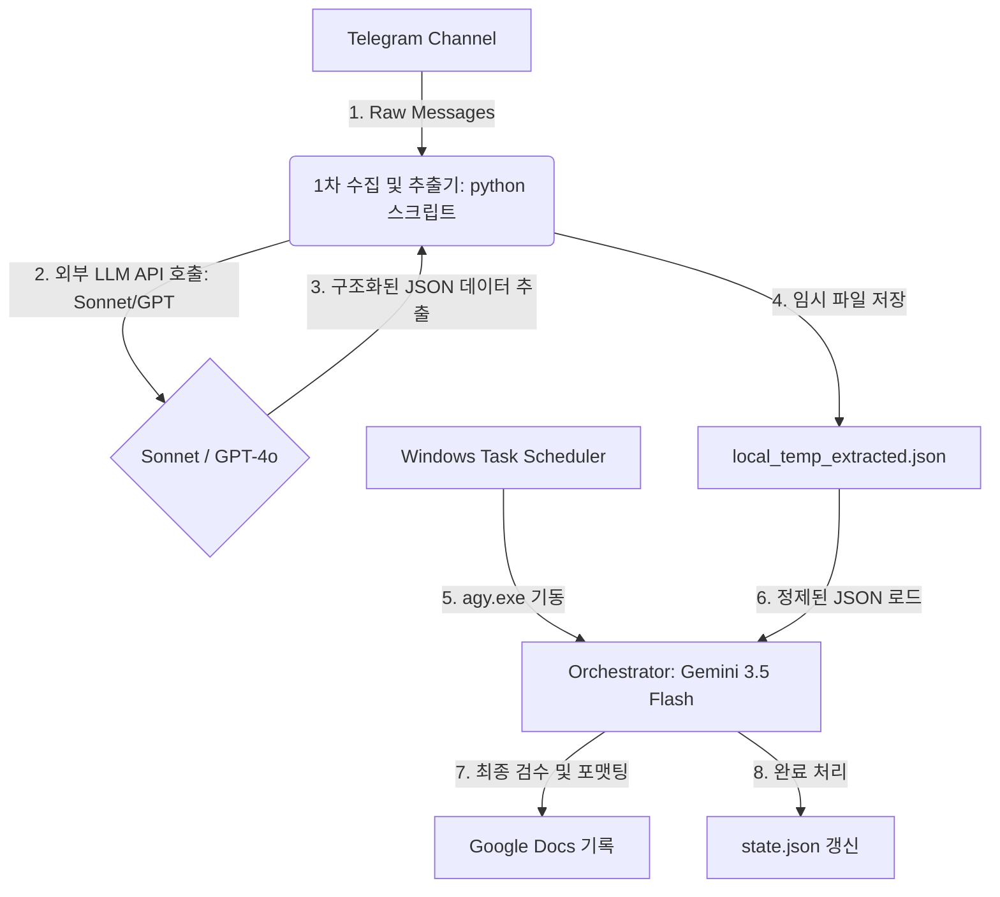

# 하이브리드 LLM 배치 업무 분담 전략

매일 아침 배치 작업 시 대량의 텔레그램 메시지를 한 번에 분석하면서 발생하는 토큰 소모 문제와 컨텍스트 초과로 인한 중단 현상을 해결하기 위해, **Orchestrator(Gemini 3.5 Flash)**와 **1차 수집/정제 모델(Sonnet 또는 GPT)**을 결합하는 하이브리드 아키텍처 전략을 제안합니다.

---

## 1. 역할 분담 설계



### ① 데이터 수집 및 1차 정제 (Claude 3.5 Sonnet / GPT)
* **역할**: 텔레그램에서 로우(Raw) 메시지들을 긁어와 대량의 텍스트 분석을 수행하고, 리서치 가치가 있는 글만 필터링하여 테마별/종목별로 1차 분류 및 요약(JSON 구조화)을 수행합니다.
* **이유**: 원문 텍스트 분석은 토큰 소모량이 가장 크기 때문에, API 토큰 제한이 널널하고 복잡한 구조화 능력이 뛰어난 Sonnet/GPT-4o가 1차 핸들링하는 것이 효율적입니다.

### ② 전체 기획 및 최종 반영 (Gemini 3.5 Flash)
* **역할 (Orchestrator)**: 전체 배치 스케줄러의 시작과 끝을 조율합니다. 1차 정제된 JSON 결과를 읽어서 누락되거나 왜곡된 리서치 판단 논리가 없는지 최종 검수한 뒤, `google-workspace` 툴을 사용해 적절한 구글 문서에 예쁘게 포맷팅하여 기록하고 `state.json`을 최종 저장합니다.
* **이유**: 구글 워크스페이스(Docs/Drive)와의 플러그인 연동 및 로컬 배치 제어는 Gemini CLI의 고유 툴바인딩 환경(Antigravity)이 가장 잘 수행하므로, 최종 배포와 관리 오케스트레이션에 집중시킵니다.

---

## 2. 구체적인 구현 전략

### 단계 1: 1차 수집/정제용 파이썬 스크립트 구축
`D:\autoNote\telegram_extractor.py` 스크립트를 작성합니다. 이 스크립트는 다음과 같이 동작합니다.
1. `D:\autoNote\state.json`에서 `last_message_id`를 읽습니다.
2. `telegram-mcp` 가상환경의 세션 자격증명을 사용해 Telethon 라이브러리로 새 메시지들을 긁어옵니다.
3. 외부 모델 API(예: OpenAI API, Anthropic API)에 수집된 메시지들을 전달하여 `AGENTS.md` 형식에 맞는 구조화된 JSON 형태로 가공을 요청합니다.
   * *구조화 JSON 스키마 예시*:
     ```json
     {
       "message_id": 249,
       "date": "2026-07-12",
       "is_research": true,
       "theme": "반도체사이클",
       "stock": "SK하이닉스",
       "raw_content": "...원문...",
       "key_argument": "...",
       "evidence": "...",
       "logic": "...",
       "risk": "...",
       "question": "..."
     }
     ```
4. 가공된 JSON 리스트를 `D:\autoNote\extracted_messages.json` 임시 파일로 저장합니다.

### 단계 2: Orchestrator 연동 배치 파일 수정
[run_daily_batch.bat](file:///D:/autoNote/run_daily_batch.bat) 파일의 구조를 다음과 같이 개선합니다.
```cmd
@echo off
chcp 65001 > nul
setlocal

cd /d "D:\autoNote"

:: 1. 1차 추출기 가동 (Sonnet / GPT를 호출하여 extracted_messages.json 생성)
"D:\autoNote\telegram-mcp\venv\Scripts\python.exe" telegram_extractor.py

:: 2. 에이저트(Gemini 3.5 Flash) 기동하여 정제된 JSON 검수 및 Docs 최종 업로드 수행
"C:\Users\SYSADMIN\AppData\Local\agy\bin\agy.exe" --print "D:\autoNote\extracted_messages.json 파일의 정제된 리서치 데이터를 검수하고 Docs에 최종 반영해줘" --dangerously-skip-permissions

endlocal
```

### 단계 3: 에이저트(Gemini 3.5 Flash) 기입 로직 최적화
Orchestrator는 텍스트 마이닝 등의 무거운 연산을 하지 않고, 단순히 구조화된 `extracted_messages.json` 파일을 파싱하여 구글 워크스페이스 툴만 차례대로 호출하기 때문에 **토큰 사용량이 매우 적고 크래시 없이 순식간에 배치가 완료**됩니다.

---

## 3. 이 전략의 기대 효과
1. **토큰 비용 및 제약 해결**: Gemini의 컨텍스트를 과도하게 채우던 대량의 텔레그램 로우 텍스트가 제거되어 API 사용 한도를 걱정할 필요가 없어집니다.
2. **배치 안정성 극대화**: 에러가 발생하기 쉬운 텔레그램 통신 및 복잡한 분석 영역이 파이썬 스크립트 레벨로 분리되어, 예외 처리와 디버깅이 훨씬 쉬워집니다.
3. **유연성**: 수집용 모델을 필요에 따라 로컬 소형 모델(Ollama 등)로도 자유롭게 변경할 수 있습니다.
